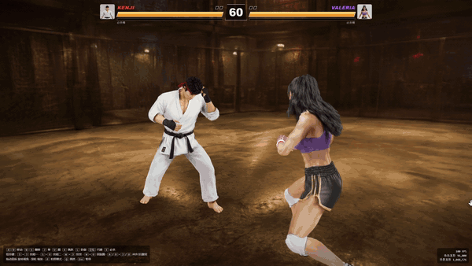
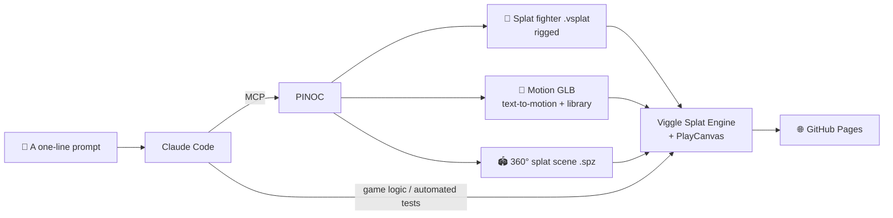

<div align="center">

<a href="https://wh1tzz.github.io/splat-fighter/"></a>

# Splat Fighter

**A browser 3D fighting game whose fighters, moves and arenas are all AI-generated Gaussian splats**

[](https://wh1tzz.github.io/splat-fighter/)


[简体中文](README.md) · **English**

[Features](#-features) · [Controls](#-controls) · [Fighters](#-fighters) · [Arenas](#-arenas) · [AI pipeline](#-ai-pipeline) · [Under the hood](#-under-the-hood) · [Run locally](#-run-locally)

</div>

---

## ✨ Features

- 🥊 **1v1 fighting**: 4 original fighters with different styles. Each has 11 single moves, combos up to 4 hits, 3 signature skills and a ~4-second super.
- 🧠 **CPU opponent**: three difficulty levels. It zones with projectiles, closes in with dash skills, anti-airs jump-ins and throws turtling players.
- 🌌 **Visuals only Gaussian splats can do**: fighters scan into existence from feet to head, KO'd fighters dissolve into points of light, dodges leave splat afterimages, and heavy hits send shockwaves across the arena floor.
- 🎥 **Cinematic presentation**: the third hit of a combo triggers 0.25× slow motion with an orbiting close-up; supers have cut-in banners, time freeze, locked combos and a negative-image impact frame.
- 🗺️ **4 360° splat arenas**: Underground Pit, Forbidden City, Colosseum, Kowloon Neon Street, about 1.05 million splats each.
- 📱 **Keyboard, gamepad or phone**: landscape touch controls with a virtual stick, and three quality tiers that step down automatically.
- 📸 **Photo mode**: pause at any moment and fly the camera freely.

## 🎮 Play

| How | Notes |
| --- | --- |
| 🌐 **Online** | Open **[wh1tzz.github.io/splat-fighter](https://wh1tzz.github.io/splat-fighter/)**. Nothing to install |
| 💻 **Locally (Windows)** | Double-click `start.bat`. It starts a local server and opens your browser (`http://localhost:8080` by default) |

Chrome or Edge recommended. WebGPU is used when available, with automatic fallback to WebGL2; if the GPU errors out or the screen stays black, the game switches backend on its own and remembers the one that works.

## 🕹️ Controls

| Action | Keyboard | Gamepad |
| --- | --- | --- |
| Walk forward / back (screen direction) | `A` / `D` | Left stick |
| Sidestep | `W` / `S` | Left stick |
| Punch / Kick | `J` / `U` | X / Y |
| Jump (punch or kick in the air = flying kick) | `K` | B |
| Block (hold) | `L` | RB |
| Dodge (hold forward = forward roll) | `Space` | A |
| Super (meter full) | `I`, or `J`+`U` together | RT |
| Skill 1 / Skill 2 | `S`+`J` / `S`+`U` | Down+X / Down+Y |
| Throw (close range, unblockable) | `W`+`J` | Up+X |
| Spinning kick | `W`+`U` | Up+Y |
| Orbit / zoom camera | Mouse drag / wheel | Right stick |
| Photo mode | `P` | Back |
| Quality / afterimages / hide HUD / pause | `Q` / `G` / `H` / `Esc` | Start |

**Pausing (Esc) shows the full move list of your fighter.**

<details>
<summary><b>📱 Phone / tablet</b></summary>

<br>

Open the page in a mobile browser and play in landscape. On Android Chrome, "Start fight" goes full screen and locks landscape; on iPhone Safari, use Share → Add to Home Screen and launch from the icon for full screen.

- Touch anywhere on the left half to spawn a stick: left/right = walk, up/down = sidestep
- 8 buttons on the right: punch, kick, jump, block (hold), dodge, super, skill 1, skill 2
- Same command inputs as the keyboard: stick down + punch = skill 1, stick up + punch = throw
- Character select: tap to pick your fighter, long-press to pick the opponent
- Phones default to the Smooth tier with lite arenas (35% of the splats, a 5 MB download instead of 16 MB)

</details>

## 🥋 Fighters

<table>
<tr>
<td align="center" width="25%"><br><b>KENJI</b><br><sub>Karate</sub></td>
<td align="center" width="25%"><br><b>VALERIA</b><br><sub>Muay Thai</sub></td>
<td align="center" width="25%"><br><b>GRIZZLY</b><br><sub>Heavyweight boxing</sub></td>
<td align="center" width="25%"><br><b>SHADE</b><br><sub>Ninja</sub></td>
</tr>
</table>

| Fighter | Skill 1 | Skill 2 | Throw | Super |
| --- | --- | --- | --- | --- |
| KENJI | Flame fireball | Rising dragon uppercut (invincible start-up) | Shoulder throw | CRIMSON THOUSAND FISTS |
| VALERIA | Lightning sweep kick | Rising knee (invincible start-up) | Clinch knees | VIOLET THUNDER ELBOW |
| GRIZZLY | Bear charge (super armor) | Ground-pound shockwave | Bear hug slam | URSA EARTHBREAKER |
| SHADE | Kunai | Phantom slash (passes through attacks) | Arm-lock throw | NEON PHANTOM BLADE |

<details>
<summary><b>📜 Full move sets and stances</b></summary>

<br>

Each fighter has a complete set of text-to-motion moves generated with PINOC: a stance, 8 moves, a super and a victory pose. Every move starts from and returns to that fighter's own stance, so moves chain together naturally.

| Fighter | Stance | Moves (J / J J / J J J / back+J / U / U U / back+U / spin) | Super | Victory |
| --- | --- | --- | --- | --- |
| KENJI | Side-on, open knife hands, lead hand circling | Jab / reverse punch / hook / uppercut / front kick / roundhouse / side kick / spinning back kick | Five-punch rush + flying kick | Bow, then folded arms |
| VALERIA | High guard, rhythmic bounce | Jab / cross / horizontal elbow / rising elbow / teep / roundhouse / flying knee / spinning elbow | Left-right kicks + high spinning kick | Both fists raised |
| GRIZZLY | Tight high guard, heavy sway | Heavy jab / overhand / hook / double-fist smash / push kick / body kick / shoulder charge / spinning backfist | Charging punch + leaping slam | Flexes and chest pound |
| SHADE | Low square stance, palm forward | Palm strike / spear hand / knife hand / rising palm / front kick / crescent kick / side kick / backflip kick | Palm flurry + whirlwind kick | Arms folded, hand seal |

- **Skill cancels**: a normal attack that hits can cancel straight into a skill, e.g. `J J → Skill 1`.
- **Projectiles**: one at a time; two projectiles cancel each other; jumping or dodging avoids them.
- **Throws**: ignore blocking, whiff during jumps and dodges, and leave a short opening when they miss.
- **Supers**: activation → arena dims + cut-in banner → time freeze while charging (invincible) → the first hit locks the opponent into the combo → negative-image impact frame finish. If the first hit misses, the whole super is wasted.

</details>

## 🗺️ Arenas


| Arena | Scene |
| --- | --- |
| Underground Pit | An underground fight club in an abandoned warehouse, chain-link fence and industrial lamps |
| Forbidden City | The Hall of Supreme Harmony at dusk, marble steps, red walls and golden roofs |
| Colosseum | A sand arena in the afternoon, ringed by tiers of stone arches |
| Kowloon Neon Street | A Hong Kong street after rain, neon signs reflected on the wet road |

## 🤖 AI pipeline

No modelers, no motion-capture studio, no game-engine editor. **PINOC makes the people and the moves, Claude writes the rules and the code, and a human decides whether it's fun.**



### Tools

| Tool | Role in this project |
| --- | --- |
| **PINOC** ([Viggle](https://viggle.ai)) | Generated every visual asset: 4 Gaussian-splat fighters (with MetaHuman-spec skeletons), 123 fighting motions and 4 360° splat arenas |
| **Claude Code** | Wrote all the game code (~4,500 lines of plain JS), called PINOC over MCP, screenshotted and compared motion samples in a headless browser, and ran AI-vs-AI matches to verify that hits connect |
| **Viggle Splat Engine** + **PlayCanvas 2.18** | Real-time rendering of splat fighters, skeletal animation and splat scenes (WebGPU first, WebGL2 fallback) |
| **GitHub Pages** | Static hosting: open the page and play |

### Assets (all generated with PINOC)

| Asset | Count | Notes |
| --- | --- | --- |
| Fighters | 4 | Each in high (48K splats, ~1.2 MB) and performance (16K splats, ~0.4 MB) tiers |
| Motions | 123 | Generic moves from the free motion library + signature moves from text-to-motion; 270+ candidate samples compared along the way |
| Arenas | 4 | ~1.05M splats each; phones use a 35% lite version |
| Cost | ~317 credits | Fighters 40, arenas 77, motions 200 |

> Example signature-move prompt:
> `karate fighter, explosive reverse punch, drives off the back leg, fist snaps out and snaps straight back to guard`
>
> Early punches peaked at 1–5 m/s and looked limp; adding *explosive / snaps out / drives off the back leg* to the prompt pushed them to 8–20 m/s.

## 🛠️ Under the hood

<details>
<summary><b>Making AI-generated motions actually connect</b></summary>

<br>

- **Every move is measured on load**: frame by frame, the game finds when the fist, foot, elbow or knee can reach the opponent, at what turn angle and how far (`measureStrike` in `main.js`).
- **Real contact only**: a hit counts only when the swinging limb touches the opponent's body, including every hit of a super.
- **Unified facing**: library motions and text-to-motion clips have root bones 180° apart; the offset is baked into the pelvis on load so switching moves never spins the fighter.
- **Skeleton-level impact**: the striking limb stretches into a smear frame on hit, the torso squashes on heavy hits, and the chest and arms swell while a super charges, all in about 0.5 ms.

</details>

<details>
<summary><b>Quality tiers and performance</b></summary>

<br>

| Tier | Per fighter | Render scale | Effects |
| --- | --- | --- | --- |
| High | 48,000 splats | 100% | All |
| Standard | 16,000 splats | 100% | All |
| Smooth | 16,000 splats | 70% | 40% particles, no smoke, no super afterimages |

- First launch picks a tier automatically: Smooth when WebGPU is missing, the CPU has ≤ 4 cores or memory is ≤ 4 GB.
- If the frame rate stays under 30 for 5 seconds in a fight, the game drops one tier.
- Motions ship as a ~5.23 MB gzip pack instead of 118 requests (~13.44 MB of GLB); unpacked files are byte-identical, with an automatic per-file fallback.

</details>

<details>
<summary><b>Debug parameters</b></summary>

<br>

| Parameter | Effect |
| --- | --- |
| `?renderer=webgl` / `raster` / `auto` | Choose the rendering backend |
| `?webgl` | Force WebGL2 to simulate a machine without WebGPU |
| `?lite` / `?full` | Preview lite arenas on desktop / force full arenas on mobile |
| `?nocull` | Disable point-cloud frustum culling |

</details>

## 📁 Project structure

```
splat-fighter/
├── index.html
├── start.bat / serve.ps1     # One-click local run on Windows (no Node / Python)
├── src/
│   ├── main.js               # Loading, character select, rounds, hit detection, slow-mo, HUD
│   ├── fighter.js            # Fighter state machine, moves, combos, hit reactions, afterimages
│   ├── ai.js                 # CPU opponent (easy / normal / hard)
│   ├── camera.js             # Fighting camera, free orbit, close-up shots
│   ├── fx.js                 # Hit sparks, arena shockwaves, super finishers
│   ├── input.js / touch.js   # Keyboard and gamepad / mobile virtual stick
│   ├── compat.js             # Browser and rendering-backend adaptation
│   ├── motion-pack.js        # Motion pack loading and fallback
│   └── config.js             # Roster, frame data, arenas, balance
├── assets/
│   ├── characters/           # Splat fighters .vsplat + portraits
│   ├── motions/              # Motion GLBs
│   └── env/                  # Splat arenas .spz
├── scripts/                  # Motion pack builder
├── tests/                    # Browser-compat and motion-pack regression tests
└── vendor/                   # Pinned splat-engine, PlayCanvas and other dependencies
```

## 🚀 Run locally

```bash
git clone https://github.com/Wh1tZz/splat-fighter.git
cd splat-fighter
start.bat
```

No Node or npm needed: `serve.ps1` runs a static server with the PowerShell that ships with Windows. On other systems, serve the project root with any static server, e.g. `npx serve .`.

**Tweaking and extending:**

- Tune the feel in `MOVES` and `TUNING` in `src/config.js`.
- Add an arena: drop a `.spz` into `assets/env/` and add a line to `STAGES`.
- Add a fighter: generate it with PINOC, put it in `assets/characters/` and register it in `ROSTER`.
- After replacing motion files: bump `MOTION_VERSION` in `src/main.js`, then run `node scripts/build-motion-pack.cjs`.

**Tests:**

```bash
node tests/browser-compat.test.cjs
node tests/motion-pack.test.cjs
```

## ⚠️ Known limitations

- Players can't yet upload a photo to generate their own fighter in the browser; that needs a PINOC API callable from a web server.
- `@viggle/splat-engine` 0.2.0 depends on PlayCanvas 2.18.0 internals. Both are pinned in `vendor/`; don't upgrade either one on its own.

## 🙏 Credits

- PINOC ([Viggle](https://viggle.ai)): fighter, motion and arena generation
- [Viggle Splat Engine](https://viggle.ai) and [PlayCanvas](https://playcanvas.com/): Gaussian splat rendering
- [Claude Code](https://www.anthropic.com/claude-code): game code and automated testing

<div align="center">

<br>

**If you enjoyed it, a ⭐ Star means a lot**

</div>
