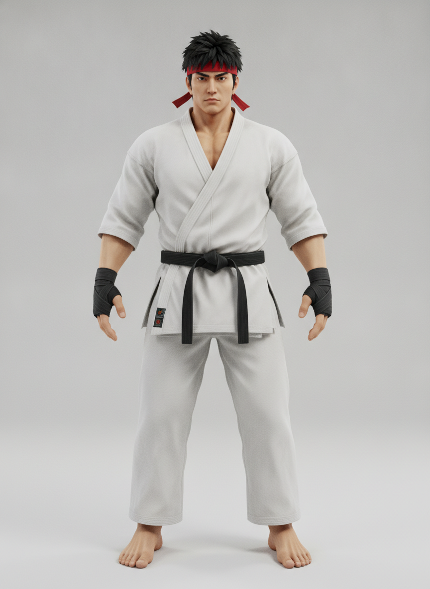
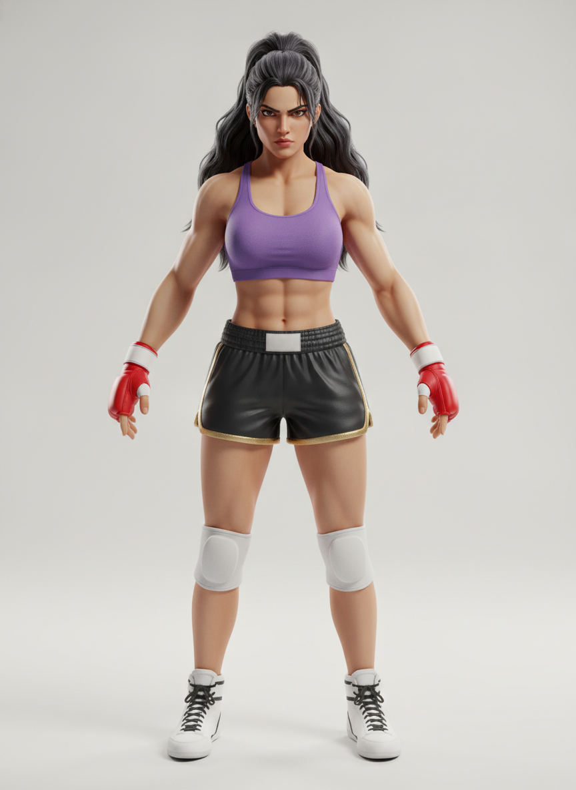
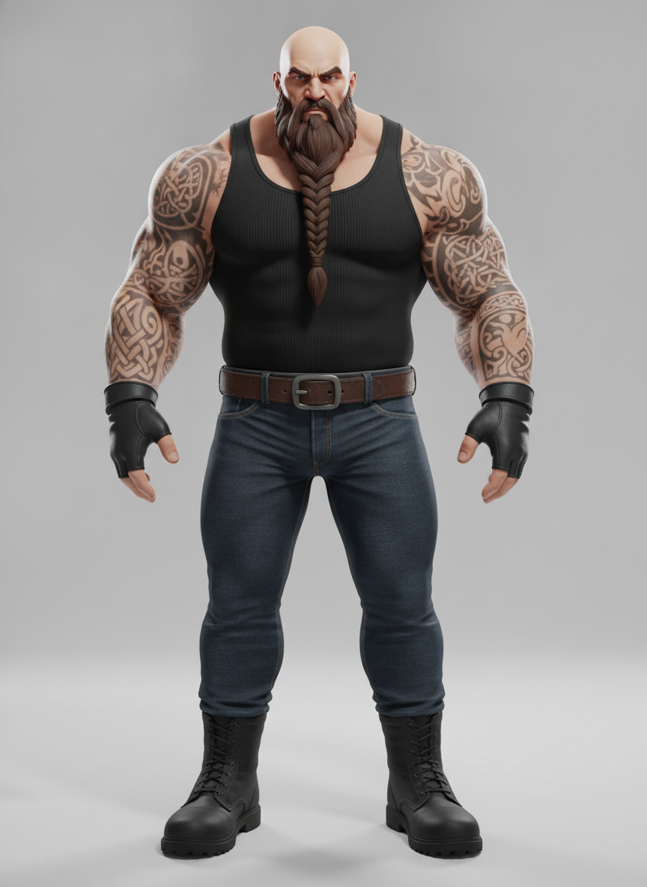
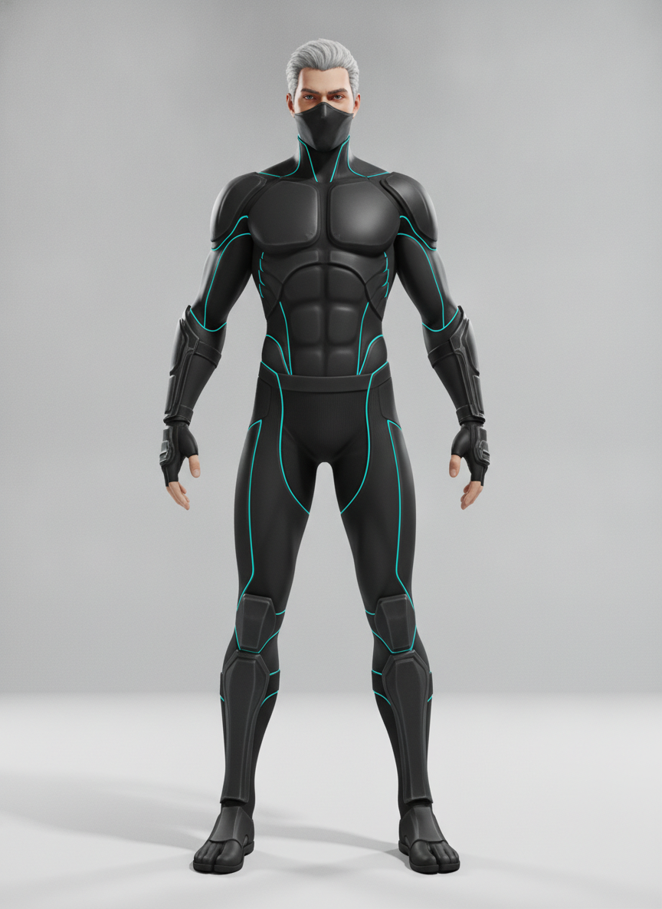
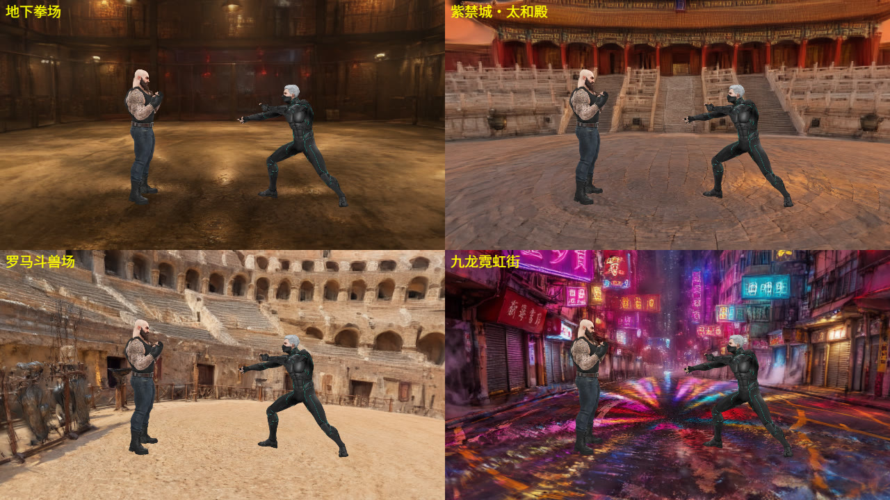
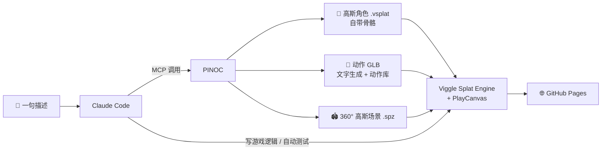

<div align="center">

<a href="https://wh1tzz.github.io/splat-fighter/"></a>

# Splat Fighter

**一款角色、动作、擂台全部由 AI 生成的网页 3D 高斯泼溅格斗游戏**

[](https://wh1tzz.github.io/splat-fighter/)


[English](README.md) · **简体中文**

[玩法特色](#-玩法特色) · [操作](#-操作) · [角色](#-角色) · [擂台](#-擂台) · [AI 制作流程](#-ai-制作流程) · [技术实现](#-技术实现) · [本地运行](#-本地运行)

</div>

---

## ✨ 玩法特色

- 🥊 **1v1 格斗**：4 名流派不同的原创格斗家，每人 11 个单招、最长 4 段连招、3 个专属技能、1 套约 4 秒的必杀演出。
- 🧠 **电脑对手**：入门 / 普通 / 高手三档，会用飞行道具牵制、突进贴身、无敌技反跳入、投技破防。
- 🌌 **只有高斯泼溅才能做的画面**：选人时角色从脚到头扫描成形，KO 时败者消散成光点，闪避留下高斯残影，重击让擂台地面泛起冲击波。
- 🎥 **电影化演出**：第 3 段连击 0.25 倍慢镜头环绕特写，必杀技有切入横幅、时间冻结、锁定连打和负片冲击帧。
- 🗺️ **4 张 360° 高斯擂台**：地下拳场、紫禁城·太和殿、罗马斗兽场、九龙霓虹街，每张约 105 万个高斯。
- 📱 **电脑、手柄、手机都能玩**：手机横屏使用虚拟摇杆，三档画质自动降级。
- 📸 **拍照模式**：战斗中随时暂停，360° 自由运镜。

## 🎮 立即游玩

| 方式 | 说明 |
| --- | --- |
| 🌐 **在线** | 打开 **[wh1tzz.github.io/splat-fighter](https://wh1tzz.github.io/splat-fighter/)**，无需安装 |
| 💻 **本地（Windows）** | 双击 `start.bat`，自动启动本地服务器并打开浏览器（默认 `http://localhost:8080`） |

推荐 Chrome 或 Edge。支持 WebGPU 时优先使用，否则自动回退到 WebGL2；画面异常或黑屏时也会自动切换后端，并记住可用的那一个。

## 🕹️ 操作

| 动作 | 键盘 | 手柄 |
| --- | --- | --- |
| 前后移动（按屏幕方向） | `A` / `D` | 左摇杆 |
| 侧移绕步 | `W` / `S` | 左摇杆 |
| 拳 / 踢 | `J` / `U` | X / Y |
| 跳跃（空中按拳或踢 = 飞踢） | `K` | B |
| 防御（按住） | `L` | RB |
| 闪避（按住前进 = 前滚） | `Space` | A |
| 必杀（槽满时） | `I`，或 `J`+`U` 同按 | RT |
| 技能一 / 技能二 | `S`+`J` / `S`+`U` | 下+X / 下+Y |
| 投技（近身，无视防御） | `W`+`J` | 上+X |
| 回旋踢 | `W`+`U` | 上+Y |
| 旋转视角 / 缩放 | 拖动鼠标 / 滚轮 | 右摇杆 |
| 拍照模式 | `P` | Back |
| 切换画质 / 残影 / 隐藏界面 / 暂停 | `Q` / `G` / `H` / `Esc` | Start |

**暂停（Esc）时会显示当前角色的完整招式表。**

<details>
<summary><b>📱 手机 / 平板操作</b></summary>

<br>

用手机浏览器打开网页，横屏游玩。安卓 Chrome 点「开始战斗」后会自动全屏并锁定横屏；iPhone Safari 请「分享 → 添加到主屏幕」，从主屏幕图标打开即为全屏。

- 左半屏任意位置按下即出现摇杆：左右 = 前进 / 后退，上下 = 侧移绕步
- 右侧 8 个按钮：拳、踢、跳、防（按住）、闪避、必杀、技一、技二
- 组合招和键盘一致：摇杆向下 + 拳 = 技能一，摇杆向上 + 拳 = 投技
- 选人：点按选自己的角色，长按选对手
- 手机默认「流畅」画质，场景改用精简版（保留 35% 高斯，下载 5 MB 而不是 16 MB）

</details>

## 🥋 角色

<table>
<tr>
<td align="center" width="25%"><br><b>KENJI</b><br><sub>空手道</sub></td>
<td align="center" width="25%"><br><b>VALERIA</b><br><sub>泰拳</sub></td>
<td align="center" width="25%"><br><b>GRIZZLY</b><br><sub>重量级拳击</sub></td>
<td align="center" width="25%"><br><b>SHADE</b><br><sub>忍者</sub></td>
</tr>
</table>

| 角色 | 技能一 | 技能二 | 投技 | 必杀技 |
| --- | --- | --- | --- | --- |
| KENJI | 烈焰气功波 | 升龙拳（起身无敌） | 过肩摔 | 红莲千本突 CRIMSON THOUSAND FISTS |
| VALERIA | 闪电扫踢 | 飞膝升天（起身无敌） | 缠颈膝撞 | 紫电·雷霆飞肘 VIOLET THUNDER ELBOW |
| GRIZZLY | 熊冲撞（霸体） | 震地重拳（地波） | 熊抱摔 | 熊王·裂地击 URSA EARTHBREAKER |
| SHADE | 苦无 | 瞬影斩（穿越攻击） | 锁臂摔 | 霓影·千刃斩 NEON PHANTOM BLADE |

<details>
<summary><b>📜 完整招式与架势</b></summary>

<br>

每个角色都有一整套 PINOC 文字生成的专属动作：架势、8 个招式、必杀技、胜利动作。每个招式都从该角色自己的架势起手、打完回到同一架势，所以招式之间衔接自然。

| 角色 | 待机架势 | 招式（J / J J / J J J / 后退+J / U / U U / 后退+U / 回旋） | 必杀构成 | 胜利动作 |
| --- | --- | --- | --- | --- |
| KENJI | 侧身、张开手刀，前手画圈佯攻 | 刺拳 / 正拳突 / 勾拳 / 上勾拳 / 前踢 / 回旋踢 / 侧踹 / 回旋后踢 | 五连拳 + 飞踢 | 鞠躬后抱臂 |
| VALERIA | 高架守，有节奏地点步 | 刺拳 / 直拳 / 平肘 / 上挑肘 / 蹬踢 / 扫踢 / 飞膝 / 回旋肘 | 左右扫踢 + 高位回旋踢 | 双拳高举 |
| GRIZZLY | 严密高架守，沉稳晃动 | 重刺拳 / 抡摆重拳 / 勾拳 / 双拳砸击 / 推踢 / 扫肋踢 / 肩撞 / 回旋背拳 | 冲锋重拳 + 跃起砸地 | 秀二头肌、捶胸 |
| SHADE | 正身低架，一掌前探 | 掌击 / 贯手 / 手刀 / 上挑掌 / 前踢 / 新月踢 / 侧踢 / 后空翻踢 | 掌击连打 + 旋风踢 | 抱臂结印 |

- **技能取消**：普通攻击打中后可以直接接技能，例如 `J J → 技能一`。
- **飞行道具**：同时只能有一发；两发相撞会抵消；跳起或闪避可以躲过。
- **投技**：无视防御，专治一直按防御的对手；抓空会有短暂破绽。
- **必杀演出**：发动 → 场景压暗 + 切入横幅 → 蓄力时间冻结（无敌）→ 第一击命中即锁定连打 → 负片冲击帧终结。第一击落空则整套作废。

</details>

## 🗺️ 擂台



| 擂台 | 场景 |
| --- | --- |
| 地下拳场 | 废弃仓库里的地下格斗场，铁丝网与工业吊灯 |
| 紫禁城·太和殿 | 黄昏的太和殿广场，汉白玉台阶与红墙金瓦 |
| 罗马斗兽场 | 午后的沙地竞技场，四周是层层石拱看台 |
| 九龙霓虹街 | 雨后的香港街道，湿地面倒映满街霓虹招牌 |

## 🤖 AI 制作流程

这个游戏没有建模师、没有动捕棚，也没有用游戏引擎编辑器。**PINOC 负责“人和动作”，Claude 负责“规则和代码”，人负责“好不好玩”。**



### 用到的工具

| 工具 | 在项目中的作用 |
| --- | --- |
| **PINOC**（[Viggle](https://viggle.ai)） | 生成全部美术资源：4 名高斯角色（自带 MetaHuman 规格骨骼）、123 段格斗动作、4 张 360° 高斯擂台 |
| **Claude Code** | 编写全部游戏代码（约 4,500 行原生 JS），通过 MCP 调用 PINOC，在无头浏览器里自动截图、比较动作样本、跑 AI 对 AI 对局验证命中 |
| **Viggle Splat Engine** + **PlayCanvas 2.18** | 实时渲染高斯角色、骨骼动画和高斯场景（WebGPU 优先，WebGL2 兜底） |
| **GitHub Pages** | 静态托管，打开网页即玩 |

### 资源一览（全部由 PINOC 生成）

| 资源 | 数量 | 说明 |
| --- | --- | --- |
| 角色 | 4 名 | 每人 high（48K 高斯，约 1.2 MB）和 performance（16K 高斯，约 0.4 MB）两档 |
| 动作 | 123 段 | 免费动作库的通用动作 + 文字生成（text-to-motion）的专属招式；挑选过程中比较了 270 多个备选样本 |
| 场景 | 4 张 | 每张约 105 万个高斯，手机使用 35% 精简版 |
| 成本 | 约 317 积分 | 角色 40、场景 77、动作 200 |

> 专属招式的 prompt 示例：
> `karate fighter, explosive reverse punch, drives off the back leg, fist snaps out and snaps straight back to guard`
>
> 早期生成的出拳峰值速度只有 1–5 m/s，看着“软绵绵”；在 prompt 里加入 *explosive / snaps out / drives off the back leg* 后提升到 8–20 m/s。

## 🛠️ 技术实现

<details>
<summary><b>让 AI 生成的动作真的“打得中”</b></summary>

<br>

- **自动测量每一招**：载入时逐帧分析拳、脚、肘、膝在哪一帧、以多大转身角度能碰到对手、最远能打多远（`main.js` 的 `measureStrike`）。
- **真实接触判定**：只有正在挥动的关节碰到对手身体才算命中，必杀技每一下也要真实接触。
- **统一动作朝向**：动作库与文字生成动作的根骨骼朝向相差 180°，载入时烘焙进骨盆，切换动作不会原地转圈。
- **骨骼级打击感**：命中时出击肢体拉长形成“拖影帧”，重击时躯干压扁，必杀蓄力时胸臂膨胀，每次约 0.5 ms。

</details>

<details>
<summary><b>画质分级与性能</b></summary>

<br>

| 档位 | 每个角色 | 渲染分辨率 | 特效 |
| --- | --- | --- | --- |
| 高 | 48,000 高斯 | 100% | 全部 |
| 标准 | 16,000 高斯 | 100% | 全部 |
| 流畅 | 16,000 高斯 | 70% | 粒子 40%、无烟雾、无必杀残影 |

- 首次打开自动判断：不支持 WebGPU、CPU ≤ 4 核或内存 ≤ 4 GB 时默认「流畅」。
- 战斗中帧率连续 5 秒低于 30，自动降一档。
- 动作资源打成约 5.23 MB 的 gzip 包，替代 118 次请求、约 13.44 MB 的 GLB；解压后与原文件逐字节一致，失败时自动回退逐文件加载。

</details>

<details>
<summary><b>调试参数</b></summary>

<br>

| 参数 | 作用 |
| --- | --- |
| `?renderer=webgl` / `raster` / `auto` | 指定渲染后端 |
| `?webgl` | 强制 WebGL2，模拟不支持 WebGPU 的机器 |
| `?lite` / `?full` | 电脑预览精简场景 / 手机强制完整场景 |
| `?nocull` | 关闭点云视锥剔除 |

</details>

## 📁 项目结构

```
splat-fighter/
├── index.html
├── start.bat / serve.ps1     # Windows 一键本地运行（无需 Node / Python）
├── src/
│   ├── main.js               # 启动加载、选人、回合流程、命中判定、慢镜头、HUD
│   ├── fighter.js            # 角色状态机、招式、连招、受击、残影
│   ├── ai.js                 # 电脑对手（入门 / 普通 / 高手）
│   ├── camera.js             # 格斗镜头、自由旋转、特写运镜
│   ├── fx.js                 # 命中火花、擂台冲击波、必杀终结特效
│   ├── input.js / touch.js   # 键盘、手柄 / 手机虚拟摇杆
│   ├── compat.js             # 浏览器与渲染后端适配
│   ├── motion-pack.js        # 动作资源包加载与回退
│   └── config.js             # 角色名单、招式帧数据、擂台、平衡参数
├── assets/
│   ├── characters/           # 高斯角色 .vsplat + 立绘
│   ├── motions/              # 动作 GLB
│   └── env/                  # 高斯擂台 .spz
├── scripts/                  # 动作资源包构建
├── tests/                    # 浏览器兼容与资源包回归测试
└── vendor/                   # 固定版本的 splat-engine、PlayCanvas 等依赖
```

## 🚀 本地运行

```bash
git clone https://github.com/Wh1tZz/splat-fighter.git
cd splat-fighter
start.bat
```

不需要安装 Node 或 npm，`serve.ps1` 用 Windows 自带的 PowerShell 起一个静态服务器。其他系统用任意静态服务器打开项目根目录即可，例如 `npx serve .`。

**修改与扩展：**

- 调整手感：改 `src/config.js` 里的 `MOVES` 和 `TUNING`。
- 新增擂台：把 `.spz` 放进 `assets/env/`，在 `STAGES` 里加一行。
- 新增角色：用 PINOC 生成后放进 `assets/characters/`，在 `ROSTER` 里登记。
- 更换动作文件后：把 `src/main.js` 的 `MOTION_VERSION` 加 1，再运行 `node scripts/build-motion-pack.cjs`。

**测试：**

```bash
node tests/browser-compat.test.cjs
node tests/motion-pack.test.cjs
```

## ⚠️ 已知限制

- 玩家还不能在网页里上传照片自助生成角色，需要 PINOC 提供可从线上调用的接口。
- `@viggle/splat-engine` 0.2.0 依赖 PlayCanvas 2.18.0 的内部实现，两者都固定在 `vendor/` 中，请勿单独升级。

## 🙏 致谢

- PINOC（[Viggle](https://viggle.ai)）：角色、动作与场景生成
- [Viggle Splat Engine](https://viggle.ai) 与 [PlayCanvas](https://playcanvas.com/)：高斯泼溅渲染
- [Claude Code](https://www.anthropic.com/claude-code)：游戏代码与自动化测试

<div align="center">

<br>

**觉得有意思的话，欢迎点个 ⭐ Star**

</div>
